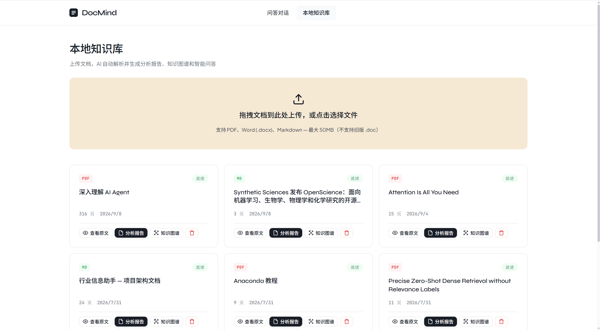
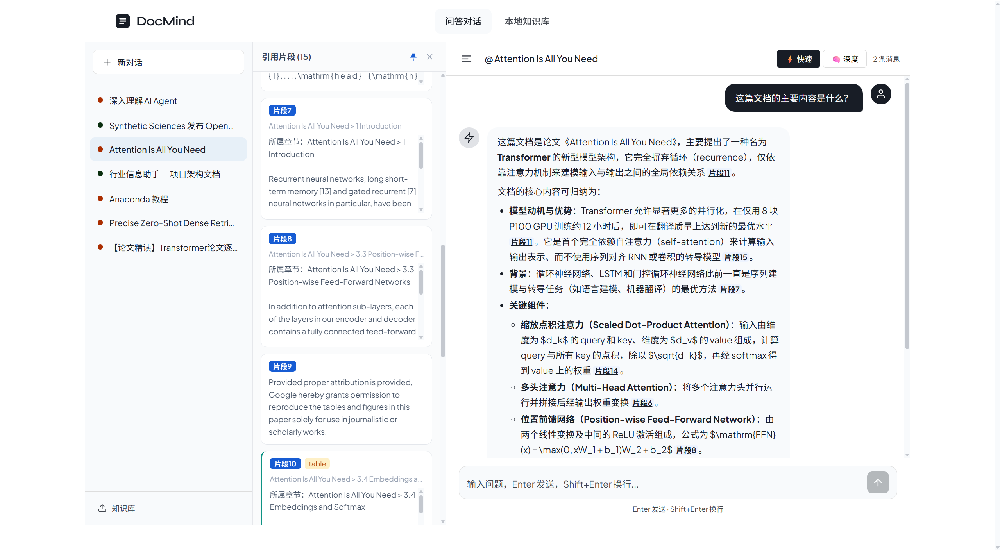
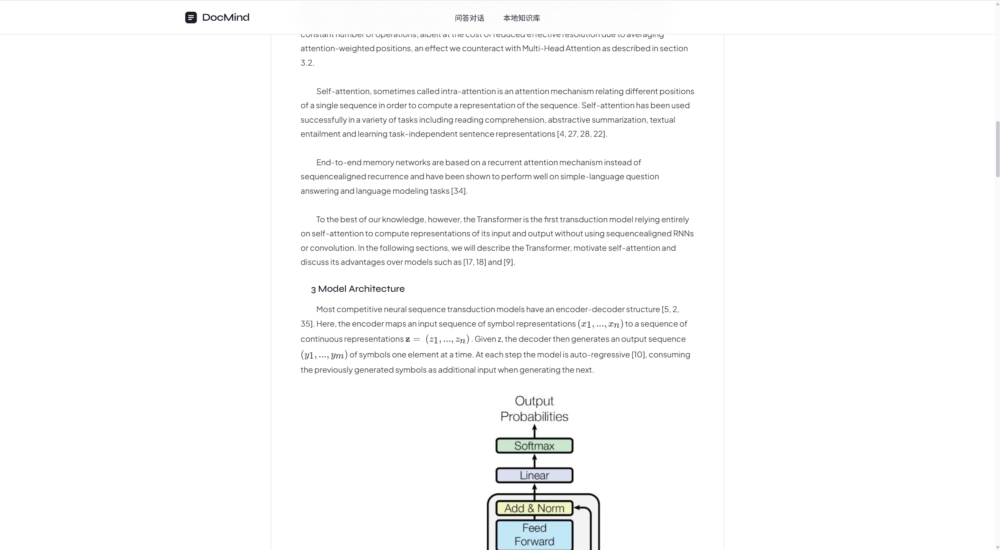

# 智学伴 DocMind — 基于 RAG 的智能教学辅助平台

<p align="center">
  <b>上传教材课件 → 自动解析建库 → 知识图谱 · 阅读报告 · 可溯源智能问答</b>
</p>

<p align="center">
  
  
  
  
  
</p>

> 独立设计开发的全栈 RAG 项目。围绕教学文档**章节层级复杂、概念密度高、长文档跨章节检索难、AI 回答不可信**四大痛点，在文档解析、混合检索、幻觉控制与 Agent 问答上做了系统性的工程落地。

## 界面预览

| 本地知识库 | 可溯源问答 |
|---|---|
|  |  |
| **AI 分析报告** | **文档原文** |
|  |  |

## 核心特性

- **离线解析与知识库构建**：基于 [MinerU](https://github.com/opendatalab/MinerU) 实现 PDF / DOCX / PPTX / MD 多格式统一解析，完整保留标题路径、页码与表格元信息，公式/表格/参考文献解析还原率 **95%+**；LLM 自动抽取概念关系构建课程知识图谱（D3 力导向可视化）
- **三层混合检索（自研）**：bge-m3 向量 + BM25（rank-bm25 + jieba）双路召回 → RRF（k=60）融合去重 → bge-reranker-v2-m3 CrossEncoder 精排；短查询重关键词、长查询重语义，检索+精排端到端延迟 **0.1s（GPU）**
- **多轮问答与幻觉控制**：多轮上下文保持 + 查询改写消解指代；结构化标记隔离、输入消毒（正则过滤注入指令）、三种不确定性处理规则（完全匹配 / 部分覆盖 / 完全无关拒答），回答强制以 `[片段N]` 标注出处，前端点击引用号高亮原文
- **生成阶段优化**：评估 → 拆解 → 批判 → 指南 **四步强制流程**的批判性阅读报告，篇幅自适应分析深度（短篇全量 / 中篇标准 / 长篇骨架 + 章节 deep-dive）；全链路容错：检索空值拒绝生成、JSON 解析降级、思维链自动过滤
- **ReAct Agent 深度问答**：最多 8 轮工具循环，内置检索文档 / 定位章节 / 查询知识图谱 / 关键词搜索 / 联网搜索 / 反思自检 6 个工具，支持会话断点续传
- **生产级工程化**：SQLite 任务队列状态机（原子认领 / 并发限流 / 超时熔断 / 失败重试）、request_id 全链路可观测 + JSONL 指标打点、LLM 统一容错层（超时重试 / 降级回退 / 每日 token 预算）

## 系统架构

```
┌─────────────────────────── 离线建库 ───────────────────────────┐
│                                                                │
│  文档上传 ──→ MinerU 解析 ──→ 智能分块 ──→ bge-m3 向量化        │
│  (异步任务队列)  (结构化JSON)  (heading_path)   (1024维,GPU)     │
│                                     │                          │
│                                     ▼                          │
│                          Milvus 向量库 + BM25 倒排索引          │
└────────────────────────────────┬───────────────────────────────┘
                                 │
┌─────────────────────────── 在线问答 ───────────────────────────┐
│                                ▼                               │
│  查询改写 ──→ 双通道召回 ──→ RRF 融合 ──→ CrossEncoder 精排     │
│  (指代消解)   (向量 ∥ BM25)    (k=60去重)   (bge-reranker)      │
│                                     │                          │
│                                     ▼                          │
│        可溯源回答 [片段N] · 批判性报告 · ReAct Agent · 知识图谱  │
└────────────────────────────────────────────────────────────────┘
```

## 检索质量评估

基于人工标注测试集，采用 MRR / Recall@5 / NDCG / MAP 等指标系统评估：

| 指标 | 优化前 | 优化后 | 变化 |
|---|---|---|---|
| Recall@5 | 58% | **87%** | +29pt |
| MRR | 0.51 | **0.71** | +0.20 |
| NDCG@5 | — | — | **+35%** |
| MAP@10 | — | — | **+21%** |
| 端到端检索+精排延迟 | — | **0.1s** | 本地 GPU |
| 连续 10 轮追问准确率 | 0.81 | **0.78** | 仅降 0.03 |
| 语义分块边界完整率 | — | **96%** | 代码/表格原子化 |

## 技术栈

| 层 | 选型 |
|---|---|
| 后端 | Python · FastAPI · SQLite 任务队列 · SSE 流式 · pytest · ruff |
| 前端 | React 18 · TypeScript · Vite · D3 力导向图 · KaTeX · markmap · react-pdf |
| 检索与模型 | Milvus 2.4 · rank-bm25 + jieba · bge-m3 · bge-reranker-v2-m3 · MinerU · DeepSeek / Qwen API |
| 基础设施 | Docker Compose（Milvus + MinIO + etcd）· 本地 GPU 推理 |
| 后训练（实验） | verl 框架 · GRPO · 可验证奖励（引用忠实度 / 格式 / 正确性）· DeepSeek-R1-Distill-Qwen-1.5B |

## 环境要求

- Python 3.10+（嵌入 / 精排推荐 NVIDIA GPU，纯 CPU 亦可运行但延迟较高）
- Node.js 18+
- Docker（运行 Milvus）
- Milvus 2.4（由下方 Docker Compose 启动）

## 快速开始

### 1. 启动 Milvus

```bash
docker compose -p docmind -f docker-compose.milvus.yml up -d
```

### 2. 配置并启动后端（:8000）

> 后端依赖 conda 的 pytorch 环境（GPU 加速嵌入 / 精排），请先激活后再启动。

```bash
cd backend
pip install -r requirements.txt
cp .env.example .env    # 填入 DEEPSEEK_API_KEY 或 QWEN_API_KEY
python main.py          # 启动后自动加载嵌入/精排模型并拉起任务 worker
```

> 文档解析依赖 MinerU，建议在**独立虚拟环境**中安装（与主服务解耦，后端以子进程调用）：
> `python -m venv .venv-mineru && .venv-mineru/Scripts/pip install "mineru[core]"`
> 解析时后端会调用 `.venv-mineru` 的 `python -m mineru.cli.client`。

### 3. 启动前端（:5173）

```bash
cd frontend
npm install
npm run dev     # /api 自动代理到 localhost:8000
```

打开 <http://localhost:5173> 上传文档即可体验；API 文档见 <http://localhost:8000/docs>。

## 项目结构

```
├── backend/
│   ├── main.py                # FastAPI 入口（request_id 中间件）
│   ├── worker.py              # SQLite 任务队列 worker（可独立进程）
│   ├── routers/               # documents / chat / knowledge_graph
│   ├── services/              # 解析、分块、检索、精排、Agent、报告、LLM 容错层
│   ├── storage/               # Milvus / SQLite / 文件存储
│   ├── evaluation/            # 检索评估模块 + 金标数据集
│   └── tests/                 # 125 个单元测试
├── frontend/                  # React 18 + TS + Vite
│   └── src/pages/             # 问答对话 · 知识库 · 分析报告 · 知识图谱
├── grpo_training/             # GRPO 后训练方案（回答模型 + 裁判模型）
├── docs/screenshots/          # 界面截图
└── docker-compose.milvus.yml  # Milvus + MinIO + etcd 编排
```

## 测试

```bash
cd backend
pytest tests/          # 125 个单元测试全绿
ruff check .           # 零告警基线
```

## Roadmap

- [ ] Parent-Child 检索（子块召回、父块生成）
- [ ] BM25 语料重建任务化
- [ ] 用户鉴权与多租户
- [ ] 检索模型微调（LoRA SFT / DPO）

## License

[MIT](LICENSE)
